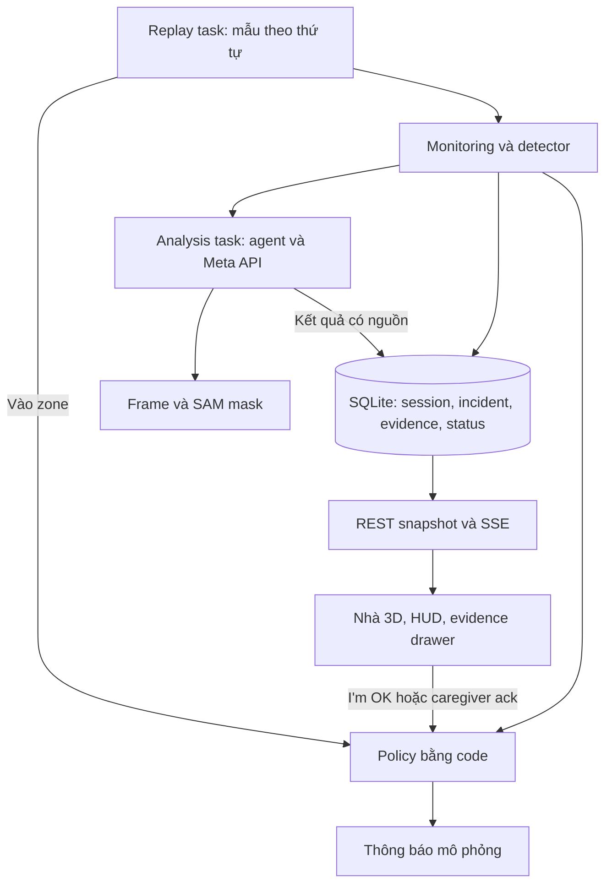

# Kiến trúc MVP 1

Bản v0.3. Đây là cấu trúc dự kiến, chưa phải implementation. Phạm vi là một process FastAPI, một replay active và một tab demo. [SPEC.md](SPEC.md) là nguồn hành vi, tiêu chí nghiệm thu và tham số.

## Nền tảng đang có

FastAPI phục vụ dashboard HTML/CSS/JavaScript tĩnh. `backend/app/api/sensor.py` nhận mẫu, gọi `fall_detection.py`, lưu `AlertEvent` trong `models/schemas.py`, gửi Telegram đồng bộ rồi phát SSE. Cooldown chung theo patient có thể chặn FALL sau instability. Gọi model trực tiếp mất khoảng 112 ms mỗi cửa sổ; bọc bằng `tf.function` còn khoảng 1,5 ms (GATES.md). Detector và broadcaster giữ trạng thái trong bộ nhớ.

Model nằm ở `ml/model_3class/` và config đã trỏ về đó. Backend load bản Keras qua TensorFlow 2.21 vì chưa có TFLite. Lớp INSTABILITY chỉ được lưu, không tạo incident (GATES.md).

`services/alert_service.py` và `models/alert_event.py` là placeholder. Khi triển khai, tích hợp vào source đang hoạt động hoặc di chuyển ownership rõ ràng, tránh sửa nhầm placeholder.

## Cách người dùng gọi hệ thống

Start tạo một run mới và task replay. Client nhận snapshot, theo dõi SSE và chọn incident. Replay task báo khi người đeo vào zone có `fall_exposure`; HUD hiện advisory. Khi ngã, người đeo có thể bấm "I'm OK" trên HUD. Người chăm sóc bấm Acknowledge trong drawer. Stop kết thúc run; refresh chỉ mở lại snapshot, không gọi Start.

Hợp đồng khái niệm dưới đây là thiết kế:

```text
start_replay(scenario_id) -> SessionSnapshot
stop_session(session_id) -> SessionSnapshot
get_snapshot(session_id) -> SessionSnapshot
get_incident(incident_id) -> IncidentDetail
record_wearer_response(incident_id, response) -> ActionResult
acknowledge_incident(incident_id, actor_id) -> ActionResult
```

## Luồng dữ liệu



Incident và trạng thái ban đầu được commit trước khi analysis bắt đầu. FALL tạo hành động Critical mà không chờ Meta. SSE phát sau commit. P0 không gửi Telegram thật. Việc refactor pipeline chung vẫn phải đưa mọi I/O gửi bên ngoài ra khỏi request ingest.

## Module sở hữu nghiệp vụ

| Vị trí đề xuất | Trách nhiệm |
|---|---|
| `services/monitoring.py` | Session, ingest, episode grouping, policy và cập nhật trạng thái incident. |
| `services/scene_context.py` | Scene/scenario manifest, frame lookup và nguồn bằng chứng. |
| `services/analysis.py` | Agent/tools, Meta adapter, validation và budget analysis. |
| `api/spatial.py` | Parse HTTP và trả snapshot/action result. |
| `models/schemas.py` | Record session, incident và bằng chứng theo layout hiện có. |
| `dashboard/spatial/scene.js` | Render nhà, camera và picking bằng Three.js. |
| `dashboard/spatial/session.js` | Start/Stop, snapshot, SSE và hành động HUD. |
| `dashboard/spatial/evidence.js` | IMU, frame, mask và summary. |

Monitoring cũng sở hữu các task timer ngắn cho simulated delivery. Một task registry giữ reference và hỗ trợ cancel khi Stop/shutdown. Chưa tạo một delivery framework, WorkItem queue hoặc scheduler tổng quát.

Khi tích hợp pipeline hiện có, cả single/batch ingest và replay dùng chung detector/grouping/policy. Route sensor không giữ một bản policy gửi trùng. Không yêu cầu client phần cứng cung cấp session/sequence mới ở P0; live hardware trong workspace spatial thuộc backlog.

## Dữ liệu tối thiểu

| Record | Trường quan trọng |
|---|---|
| Scene/scenario manifest | Version, assets, zones, object IDs, camera route, IMU refs, units và source offsets. |
| Session | ID, scenario/model/config refs, status, start/end UTC, timeout và lý do kết thúc. |
| Incident | ID, session, source interval, decision source (model hoặc luật SVM), xác suất ba lớp, location source và caregiver ack. Chỉ FALL tạo incident. |
| Advisory | Session, zone, thời điểm vào zone, frame ID, trạng thái SAM và mask ref. Không phải incident. |
| Evidence | Frame/mask/IMU ref, origin, camera/scene version, source offset và alignment error. |
| Analysis | Incident, status, model/prompt refs, input refs, tool log, summary hoặc error. |
| Action log | Incident hoặc advisory, loại action, actor/contact, thời điểm và outcome. |

Dùng `AlertEvent` làm record incident bằng các cột bổ sung và bảng con. Alert legacy có thể thiếu session/scene. Không duy trì hai bảng có cùng lifecycle độc lập. Migration cần tường minh khi triển khai.

Context detector theo session và stream. Một replay task sở hữu thứ tự mẫu của run đó. Trạng thái session gồm Running, Stopped và Interrupted. Trạng thái analysis gồm Pending, Running, Complete, NoMatch, Failed, TimedOut, Cancelled và Unavailable.

| Session status | Khi nào được đặt |
|---|---|
| Running | Start thành công; tiếp tục giữ khi recording đã hết nhưng run còn xử lý deadline. |
| Stopped | Người dùng Stop với end_reason=user_stop, hoặc hết run timeout với end_reason=timeout. |
| Interrupted | Startup phát hiện run Running còn sót sau restart; commit lỗi cũng cố gắng ghi trạng thái này theo best-effort. |

Session terminal không tự chuyển lại Running. Start tiếp theo tạo session mới. Trạng thái Complete của analysis chỉ nói lần phân tích đó đã xong, độc lập với việc run đã dừng hay chưa.

Caregiver ack dùng các trường đơn giản: acknowledged, actor và thời điểm. Incident chỉ có một mức nên không cần cơ chế ack theo mức. Wearer response là record riêng có thời điểm; không được dùng thay caregiver ack.

## Đồng hồ, hết recording và Stop

Source offset dùng để ghép IMU và frame. Run elapsed dùng monotonic clock để tính deadline 1x. UTC ghi thời điểm action. Không lấy recording date trừ ngày chạy để tính processing latency.

Start pin scenario và config. Không dùng weather forecast hiện tại để âm thầm thay threshold giữa các replay. Classifier lưu cả tên model thực sự load và nhánh quyết định model/hard_threshold/heuristic.

Hết recording giữ source offset/camera ở cuối và báo Recording ended. Run vẫn Running, timer và analysis còn được xử lý cho tới Stop hoặc run timeout. Kiểm tra scenario trước Start để deadline dự kiến có thể hoàn tất trong budget. Không có Pause/Resume hoặc Settling state.

Trong điều kiện DB hoạt động bình thường, Stop đặt session Stopped với end_reason=user_stop và analysis chưa xong thành Cancelled trước, rồi cancel task đang chờ. Mọi callback sau await kiểm tra lại session và incident trước khi tạo action. Kết quả evidence tới muộn có thể được lưu với nhãn late, nhưng không phát cảnh báo mới hoặc đổi Cancelled thành Complete. Run timeout đặt session Stopped với end_reason=timeout và đánh dấu analysis còn dở TimedOut, không coi công việc chưa xong là thành công.

Khi DB hoạt động trở lại, startup đánh dấu run Running còn sót là Interrupted và analysis Pending/Running là Failed với lý do session_interrupted. Không khôi phục detector để tiếp tục cùng run.

Commit lỗi được xử lý best-effort trong MVP 1. Cố gắng dừng/cancel task của run, log lỗi bằng kênh còn hoạt động và ghi Interrupted nếu còn ghi DB được. Không cam kết lưu được trạng thái lỗi, phục hồi nhất quán toàn bộ hoặc loại bỏ mọi side effect đang chạy trong tình huống storage lỗi. Kết quả kiểm tra được ghi riêng ở T12, không là yêu cầu transactional recovery của AC10.

## Incident, policy và task đồng thời

Detector giữ cơ chế confirmation và cung cấp observations. Grouping gom các cửa sổ liên tục, dùng normal_gap đã kiểm chứng để tách episode. Cooldown notification không được lọc mất observation FALL.

Monitoring áp dụng transition ngắn có lưu DB trước khi schedule side effect. Các action được kiểm tra/đánh dấu trên cùng event loop, không chèn await vào giữa việc kiểm tra eligibility và claim action. Mỗi task có DB session riêng; mọi task chỉ cập nhật incident thông qua cùng owner nghiệp vụ.

Một action gửi được nhận diện bằng incident và contact trong action log. Có thể dùng unique constraint nhỏ cho tổ hợp này để tránh timer/callback tạo hai thông báo mô phỏng. Đây không phải queue có idempotency protocol hoặc lease.

Vào zone `fall_exposure` tạo advisory: HUD hiện ngay, rồi một task gọi SAM trên frame lúc vào zone và ghi kết quả. Advisory có cooldown theo zone và không lên lịch thông báo. FALL chỉ mở Critical incident khi `StreamMonitor` thấy người đeo nằm yên sau đó. Incident bắt đầu ở awaiting_wearer với đếm ngược `WEARER_CANCEL_WINDOW_SECONDS`. "I'm OK" trong lúc đếm chuyển sang cancelled_by_wearer; hết đếm ngược thì chuyển alerted, contact 1 nhận simulated alert và caregiver deadline bắt đầu. Cả hai chuyển trạng thái chạy dưới khóa của run.

Caregiver ack chặn contact 2. Wearer self-report sau FALL chỉ là thông tin hiển thị cho người chăm sóc. Ack lặp lại trả cùng kết quả.

Trước mỗi dispatch kiểm tra lại session Running, caregiver ack và action đã gửi. Timer chờ không giữ transaction DB mở.

## Analysis task

Một analysis task có status lưu DB, task reference trong registry, budget tool calls và timeout toàn vòng. P0 không tự retry analysis. API dùng async I/O hoặc chạy blocking work ngoài event loop. Inference CPU cũng không được giữ event loop trong lúc làm các timer trễ.

Inputs được đóng băng cho analysis và gắn incident/frame cụ thể. Kết quả được validate trước khi lưu. Request hành động từ agent luôn qua policy hiện tại.

SAM adapter kiểm tra response format thực, kể cả định dạng segmentation tokens/parser được mô tả trong tài liệu Meta. Không giả định luôn có JSON mask. NoMatch, lỗi và timeout đều là kết quả hiển thị được.

## Nhà và hình ảnh

Scene dùng Y-up, đơn vị mét, stable IDs cho vật thể liên quan. Geometry sàn/tường/cầu thang đơn giản và bộ furniture cùng style. Tải dependency/assets cục bộ, pin version. GLB có thể nạp qua GLTFLoader. Ghi nguồn và giấy phép cho từng asset dùng.

Gate SAM chạy trên scene thô cùng phong cách, ánh sáng và camera dự kiến trước khi đầu tư nội thất. Frame export từ manifest/version đã chọn, không gồm HUD hay overlay đáp án. Camera toàn cảnh và camera kính tách riêng.

Frame lookup dùng tolerance trong SPEC, ngoài tolerance trả Unavailable. Mask chỉ vẽ trên frame nguồn. Marker nhà dùng authored location, không phải phép định vị 3D từ mask. Camera first-person không cần thấy toàn thân người đeo; IMU cung cấp bằng chứng chuyển động.

Nếu chuyển sang iPhone video, giữ Recorded video và Manual zone mapping trong provenance. Hình ảnh thật không tự làm IMU trở thành recording đồng thời hoặc nhà 3D thành scan của địa điểm thật.

## HTTP, assets và refresh

| Endpoint đề xuất | Ý nghĩa |
|---|---|
| GET `/api/spatial/scenarios` | Kịch bản và provenance. |
| POST `/api/spatial/sessions` | Start; chỉ một active run, không tạo run thứ hai khi refresh. |
| POST `/api/spatial/sessions/{id}/stop` | Stop lặp an toàn. |
| GET `/api/spatial/sessions/{id}` | Snapshot của run và config đã pin. |
| GET `/api/spatial/incidents/{id}` | Bằng chứng, analysis và action log. |
| GET `/api/spatial/incidents/{id}/imu` | Khoảng IMU giới hạn theo SPEC. |
| POST `/api/spatial/incidents/{id}/wearer-response` | Self-report sau FALL. |
| POST `/api/spatial/incidents/{id}/acknowledge` | Actor. |
| GET `/api/spatial/sessions/{id}/advisories` | Advisory của run cùng kết quả SAM. |

Legacy ack route dùng cùng owner nghiệp vụ; không duy trì hai chính sách ack.

Mount `/spatial-assets/` cho home/scenario và `/evidence/` cho artifact refs được kiểm soát. Đăng ký API và mount trước static catch-all `/`. Không expose repo root hoặc backend environment.

SSE báo thay đổi, REST snapshot giữ trạng thái chuẩn. Refresh và reconnect tải snapshot. P0 không có periodic snapshot reconciliation hoặc cam kết đồng bộ nhiều tab. Khi event/drop không phục hồi bằng reconnect, người demo có thể refresh; trạng thái đã commit vẫn còn.

## Điều đã cắt và nguồn kỹ thuật

v0.2 bỏ frontend framework mới, multi-process, WorkItem lease/retry, durable queue, AcceptedBatch sequence/hash, ack revision, Pause/Resume và detector recovery. Trước mắt task status, bounded calls và Interrupted đủ để thể hiện chính xác giới hạn bản demo.

- [Meta Model API](https://dev.meta.ai/docs/overview) và [SAM overview](https://dev.meta.ai/docs/sam/overview) là nguồn API cần đối chiếu khi chạy gate.
- [Three.js installation](https://threejs.org/manual/pages/installation.html), [GLTFLoader](https://threejs.org/docs/pages/GLTFLoader) và [OrbitControls](https://threejs.org/docs/pages/OrbitControls.html) là nguồn renderer đã đọc ở v0.1.
- [Kenney Furniture Kit](https://kenney.nl/assets/furniture-kit) là một nguồn asset CC0 đã xem; chưa xác nhận từng asset phù hợp hoặc SAM nhận tốt phong cách đó.
