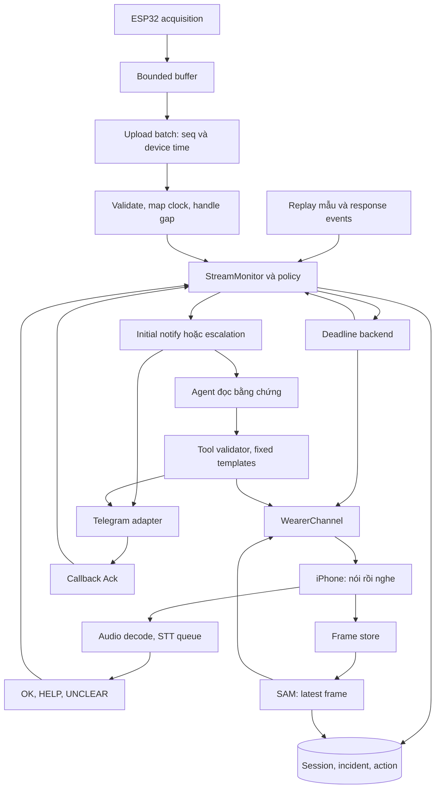

# Kiến trúc MVP 2

Bản v0.5, chốt ngày 2026-10-31. Đây là thiết kế cần triển khai. [MVP2.md](MVP2.md) là nguồn hành vi, tham số và nghiệm thu; [MVP2_PLAN.md](MVP2_PLAN.md) là lịch. Các đường replay MVP 1 không đổi hành vi.

## Ranh giới và luồng

Dùng chung `StreamMonitor` và các phép chuyển trạng thái incident. Khác biệt live/replay nằm ở nguồn mẫu, bằng chứng và đồng hồ được truyền vào. Không xây một framework nguồn dữ liệu tổng quát.

Một khóa ngắn theo session bảo vệ chuyển trạng thái, deadline và lập hành động. STT, model, SAM, Telegram và thao tác file chậm chạy ngoài khóa và event loop. Quyết định trước rồi commit, sau đó lập lịch I/O. Từng kết quả muộn phải kiểm tra session, incident, deadline và identity trước khi ghi.

## Nguồn mẫu và đường đọc

`SpatialRunManager` giữ ownership session và policy. Tách `_ingest` thành nhận các mẫu có source time thay vì chỉ số trong file. Các hàm đọc evidence chọn theo `session.kind` tại ranh giới, không yêu cầu mọi session có scenario.

| Dữ liệu | Replay MVP 1 / S3 | Live |
|---|---|---|
| IMU | File / replay journal | Journal mẫu theo session |
| Frame | Frame index | Frame store theo session |
| Response | HUD MVP 1 / S3 events | STT và wearer events |
| Location | Authored / nguồn được ghi | Unknown hoặc Manual location |
| Clock policy | Realtime MVP 1 / clock ảo S3 | Backend monotonic |

Sửa cả `session_snapshot`, `incident_detail`, `_evidence_bundle`, frame lookup và advisory. Các hàm này hiện dựa vào `load_scenario`; chỉ sửa Start/ingest không đủ. Giữ schema response phân biệt `kind`; live không trả route giả. Agent đọc cùng evidence schema, có source/status/age/uncertainty.

## Firmware và đồng hồ

Acquisition đọc cảm biến theo lịch mục tiêu, ghi mẫu vào ring buffer có giới hạn; upload chạy task khác. Buffer đầy thì bỏ theo quy tắc cố định và tăng bộ đếm, không chặn acquisition. Không đọc bù nhiều mẫu liên tiếp để giả 50 Hz sau một khoảng mạng chậm.

Batch P0 của live chứa `device_id`, `boot_id`, `batch_id`, `samples` và `dropped_at_source`. Mỗi mẫu chứa `sample_seq`, `device_ms`, `ax, ay, az, gx, gy, gz, svm`. Sequence tăng với mẫu đã thu; timestamp phản ánh thời gian thực thu. Chỉ số thiếu lịch lấy mẫu được đo riêng từ khoảng timestamp. Các trường mới bắt buộc trong live; sensor route cũ ngoài live giữ hợp đồng cũ.

- Start ràng buộc patient/device/boot; mẫu sai device bị từ chối. Duplicate không đưa vào detector lần hai; batch đảo thứ tự bị từ chối và ghi lỗi, không tự sắp lại lịch sử đã xử lý.
- Sequence gap hoặc khoảng device timestamp >40 ms ngắt cửa sổ liên tục. Device clock lùi trong cùng boot là dữ liệu hỏng: cả batch bị từ chối, kiểm tra độc lập với sequence, nên không có source time âm đi vào detector hay journal; batch hợp lệ kế tiếp tạo sequence gap và ngắt cửa sổ. Boot đổi bị từ chối cho tới khi bắt đầu phiên mới. Chậm HTTP với sequence/device timestamp liên tục không reset; thay đổi clock mapping không được giả thành gap tại nguồn. Reset detector window và candidate nằm yên, giữ incident đã mở. Boot đổi yêu cầu kết nối lại thiết bị và đồng bộ clock trước khi nhận tiếp.
- Mỗi reset ghi reason, thời gian bắt đầu unavailable và thời gian đủ lại 100 mẫu; gom các khoảng chồng nhau khi tính coverage. Snapshot có số mẫu buffered, detection readiness và thời điểm mẫu cuối. G4 dùng định nghĩa/mục tiêu coverage trong SPEC; không loại warm-up sau reset khỏi mẫu số. Theo dõi transport lag riêng, không dùng coverage dữ liệu để che độ trễ mạng.
- Thời gian IMU đến từ device monotonic, không từ `received_count × 20`. Server lưu cả thời điểm nhận; chênh lệch này đo transport lag, không tự coi là mất mẫu.
- ESP32 và iPhone thực hiện ít nhất 5 lượt clock exchange với backend trước nhận dữ liệu. Client ghi monotonic lúc gửi/nhận; server trả session time lúc nhận/trả. Chọn lượt RTT thấp nhất để ước lượng offset, lưu RTT và bất định. Đồng bộ lại mỗi phút; offset mới không được viết lại timestamp lịch sử. Clock nhảy lớn thì ngắt stream và đồng bộ lại.
- Ảnh/audio mang monotonic capture time của iPhone; backend map bằng clock mapping đã ghi. Không lấy thời điểm upload làm thời điểm chụp. Nếu chưa đo được offset/uncertainty thì ghi `Unsynchronized`, không khẳng định frame đồng thời với IMU.

`source_ms` là thời gian trong session sau mapping. Deadline policy dùng backend monotonic; lưu UTC deadline để UI hiển thị, không dùng clock iPhone để gia hạn. S3 lưu cả raw clock và source time đã ánh xạ. Sai lệch ghép frame gồm khoảng cách source time cộng bất định hai nguồn, theo mức trong SPEC.

## Dữ liệu và migration

| Record | Thiết kế |
|---|---|
| `SpatialSession` | `kind`, `patient_id`, `device_id`, `boot_id`, `scenario_id` nullable cho live, `config_snapshot`, readiness thiết bị/media/clock, `last_sample_at`, counters, `notification_mode` |
| IMU journal | Mẫu gắn session, source/device/receive time, sequence, giá trị; có thể dùng file append theo session thay vì bảng mới. Snapshot/detail đọc theo session |
| `AlertEvent` | Giữ state và deadline gốc; thêm `alert_reason`, `first_notify_at`; `response_status` và các cờ kênh độc lập theo SPEC. Actions lưu lịch sử hủy rồi xin giúp, trạng thái gửi theo liên hệ |
| `SpatialAction` | `action_id`, `incident_id`, `kind`, `target`, `by`, `detail`, source/UTC time; thêm utterance/chunk/message identity trong detail hoặc cột theo nhu cầu truy vấn |
| Clock mapping | Session, nguồn, boot/connection, offset, RTT, uncertainty và thời gian hiệu lực |
| Frame index | Frame id, capture/source/receive time, clock quality, file/hash, nhãn nguồn |
| Liên hệ | `.env`: `TELEGRAM_CHAT_ID_1/2`, người Ack được phép; không đưa token vào log/export |

Migration phải giữ DB MVP 1 đọc được và được thử trên bản sao DB cũ. Unique `(incident_id, kind, target)` hiện tại không dùng cho mọi action mới. Thay bằng key hành động cụ thể: `initial:<incident>:contact_1`, `escalate:<incident>:contact_2`, và ID riêng cho mỗi say/audio/update. Một sự kiện retry giữ cùng ID; một câu/tin mới có ID mới. Ack lặp cùng người không tạo hành động lặp, người khác Ack có thể được ghi riêng.

Audio thô chỉ ở bộ nhớ/tmp có giới hạn rồi xóa sau decode/STT. Log transcript và kết quả; ảnh và IMU nằm dưới evidence session. Chỉ dữ liệu được người tham gia đồng ý mới export vào repo. Model/config hash trong S3 không bao gồm secrets.

## WearerChannel và STT

| Endpoint | Hợp đồng |
|---|---|
| GET `/api/spatial/sessions/{id}/wearer?after=<id>` | Lời nói có `utterance_id`, incident, template/text, `listen`, deadline và nguồn code/agent |
| POST `.../wearer/played` | Gửi sau guard, kèm speech_end/listen_start theo phone monotonic; mở lượt nghe hợp lệ theo state/deadline, không gia hạn |
| POST `.../wearer/audio` | Utterance, incident, chunk id, capture start/end, clock mapping và MIME; body có giới hạn |

Polling và các quy tắc nói/nghe theo [SPEC, Kênh tiếng nói](MVP2.md#kênh-tiếng-nói); ID/câu/điều kiện phát theo [bảng câu chữ](MVP2.md#bảng-câu-chữ-p0), cấu hình theo [Tham số P0](MVP2.md#tham-số-p0). Client ghi TTS start/end, guard end, capture start/end; backend loại audio gối lên khoảng loa/guard và kiểm tra utterance ownership. Lỗi TTS không được tự đánh dấu played thành công. Giới hạn timestamp theo clock quality đã lưu.

Client giữ một pending reminder, state machine audio gồm speaking → guard → recording → finalizing. Thời gian phát thực tế và lý do hoãn/bỏ được ghi cùng utterance. Registry ánh xạ ID sang câu SPEC, không nhận prompt tự viết từ agent. Khi state/deadline đổi, vô hiệu hóa reminder cũ và chuyển chế độ listen theo policy.

Không triển khai VAD trong P0. `MediaRecorder` stop/finalize mỗi lượt theo thời lượng SPEC, kể cả lượt cuối ngắn hơn; không coi blob timeslice là file độc lập và không ghép byte hai MP4. Decoder chuẩn hóa PCM; MIME được feature-detect và kiểm tra giải mã trên iPhone trong U0.

Whisper load một lần, worker riêng ngoài event loop. Capacity, drop policy và giới hạn mất HELP theo [SPEC, Kênh tiếng nói](MVP2.md#kênh-tiếng-nói). Job có chunk/utterance/incident identity; ghi capture interval, queue depth, drop reason và các timestamp decode/STT/policy/send-schedule để đo từng chặng. Snapshot lấy cờ kênh từ heartbeat, media error, STT outcome và queue metrics; không suy ra Phone offline từ transcript trống. Duy trì các cờ độc lập, chỉ renderer chọn nhãn theo SPEC.

Normalizer và pure classifier triển khai đúng [hợp đồng phân loại P0](MVP2.md#hợp-đồng-phân-loại-p0); không giữ allowlist độc lập tại frontend. Kiểm tra trigger trên template gọi cùng normalizer/phrase matcher, thay vì chỉ chạy verdict classifier. Registry đánh dấu state được phép phát cho từng template; validator kiểm tra cả lúc chọn lẫn lúc phát.

Policy nhận STT result cùng capture interval đã được kiểm tra, thời điểm server nhận đủ file, result time, mapping id và validation status; áp dụng [bảng policy](MVP2.md#policy-do-code-quyết-định) và [hợp đồng audio muộn](MVP2.md#hợp-đồng-audio-muộn) dưới khóa session. Dùng clock mapping đã được ghi cho lượt thu, không map lại lịch sử bằng offset mới. Kiểm tra interval so với lần cấp listen/played, thứ tự/thời lượng và khoảng TTS/guard; không dùng raw timestamp client làm bằng chứng trước hạn. HELP nâng lại dùng cùng incident và initial action key, không tạo incident mới. Deadline task không được xóa evidence/job cần xét grace. Mọi lần chấp nhận/từ chối ghi reason và state lúc xử lý.

Khi Python classifier/test thay thế xong, xóa classifier JS và voice-test cũ cùng đợt.

## Countdown, Stop và restart

Config live/replay được giữ theo session, không đổi biến toàn cục từ 7 sang 30 s. Deadline mở incident theo SPEC; task chỉ là cơ chế đánh thức, policy luôn kiểm tra thời gian thực khi quyết định.

Stop đặt session Stopped, ngừng ingest/frame/advisory. Giữ incident task, khóa, worker liên quan và wearer capability cho tới khi các cửa sổ được SPEC yêu cầu đã kết thúc, kể cả help_only và grace sau hủy; không thu hồi token chỉ vì cancelled_by_wearer hoặc deadline thu đã hết. Trong grace chỉ nhận audio thuộc lượt trước hạn, không cấp lượt nghe mới. Cleanup STT/token theo hợp đồng audio muộn trong SPEC; chặn kết quả thread về sau khi grace đã đóng. Luồng nâng HELP gọi cùng hàm alert dưới khóa để giữ tính duy nhất của initial notify. Không pop registry chỉ vì input dừng. Start mới bị chặn khi session trước chưa hoàn tất các việc này. Ack và speech đã thuộc incident được chuyển vào policy để xét quyền/state/deadline trong giai đoạn đó. S3 ghi cả cancellation và lần nâng HELP để replay M5b.

Restart đánh dấu Interrupted, giữ evidence và hiển thị cảnh báo incident chưa hoàn tất. P0 không tự gửi lại hoặc khôi phục tác vụ liên lạc bên ngoài sau restart. Tình huống này phải xuất hiện trong demo failure tests.

## Telegram và quyền quyết định

Chuyển alerted và tạo initial action trong một transaction. Gửi sau commit, ngoài khóa, với timeout tổng trong SPEC. `sent` nghĩa API nhận tin, không phải người thân đọc; lỗi rõ là `failed`, timeout không biết kết quả là `unknown`. Mất token trong live thật là lỗi cấu hình, không âm thầm đổi sang simulated.

Deadline Ack bắt đầu từ lần gửi đầu, không chờ model hoặc xác nhận điện thoại nhận. Lỗi rõ của liên hệ 1 lập escalation sớm; timeout giữ deadline gốc. Ack/escalation cùng khóa: Ack được commit trước thì chặn gửi mới; action đã được quyết định trước Ack có thể đã ra ngoài, phải hiển thị đúng thứ tự. Không hứa exactly-once giao hàng khi Telegram timeout; P0 không tự retry tin có kết quả không rõ.

Một task long polling `getUpdates`, lưu update offset, trả `answerCallbackQuery`. Kiểm tra chat, sender được cấu hình, message id và incident nhận cảnh báo. Ack gọi cùng policy. Nội dung/quota/eligibility của tin nhắn và late OK lấy từ [SPEC, Agent P0](MVP2.md#agent-p0) và [bảng câu chữ](MVP2.md#bảng-câu-chữ-p0); không có bản luật quota riêng trong adapter.

Late OK dùng key `late_ok:<incident>:<contact>`; lưu trạng thái đã bao gồm trong cảnh báo đầu khi cần để chống tạo cập nhật thừa. Dưới khóa, policy kiểm tra eligibility/quota/identity và commit action; I/O gửi/sửa callback nằm ngoài khóa. Mọi tool đi qua cùng adapter/action log. Renderer lấy response và channel status từ hai trường riêng tại thời điểm lập tin, không ghi đè lời đã nhận bằng trạng thái kết nối.

## Agent P0

Giữ model/config API hiện có và kiểm tra quyền dùng ở bước triển khai. `responder.py` dùng tool đọc evidence của `incident_agent.py`, bổ sung nguồn live. Tối đa theo SPEC; task độc lập với gửi tin và escalation.

- `send_message(contact, evidence_ids)`: chỉ contact đã được policy cho phép, evidence có thật thuộc incident; renderer dùng mẫu cố định, quota dùng chung code.
- `reassure_wearer(template_id)`: allowlist câu cố định, validator kiểm tra trạng thái tại lúc phát, không chỉ lúc agent chọn. Ack không cho phép suy ra đang tới.
- Giải thích trên laptop có dẫn evidence, giới hạn nguồn, trạng thái SAM/STT; không chẩn đoán.

Không đăng ký `give_guidance`, `talk_to_wearer`, `sound_alarm`, `notify_next_contact` trong P0. Không nạp thư viện first_aid vào prompt/tool. Code kiểm tra tool và trạng thái kể cả khi model phát yêu cầu ngoài schema; log cả lần từ chối. Agent lỗi không thay đổi policy.

## Camera và bằng chứng

POST `/api/spatial/sessions/{id}/frames` nhận JPEG, frame id, capture time và clock mapping. Lưu source time/receive time/hash. Một SAM request tại một thời điểm; ứng viên mới nhất thay ứng viên cũ đang chờ. Advisory phải qua kiểm tra tuổi ảnh, mask và cooldown của SPEC; không phát trong countdown.

Khi mở incident, chọn theo source_start_ms của sự kiện. Có thể đợi ảnh gần hơn trong background trong khi notification vẫn chạy; không trì hoãn policy. Không có frame đạt tolerance thì Unavailable, không gán ảnh khác nguồn hoặc từ nhà 3D. Unknown location được giữ trong tin nhắn và explanation.

## S3 và replay

Gói `assets/scenarios/S3/` gồm:

- `manifest.json`: schema version, thiết bị, model/scaler/config hash, clock mapping/uncertainty, nguồn và quyền công bố.
- `imu.csv`: source time, sequence, device time và tín hiệu; gap/counters được giữ.
- `frames/`, `frames.json`: ảnh với capture/source/receive time, hash và nhãn camera thật.
- `responses.json`: response/Ack event id, capture start/end, clock mapping/validation, server receive/result/policy time, transcript, class, nguồn và lý do áp dụng/từ chối; đủ để replay ngoại lệ HELP muộn.
- `expected.json`: incident boundaries và chuỗi policy actions để so sánh.

Replay driver S3 đọc gói này trực tiếp, không bắt buộc route hoặc file scenario kiểu MVP 1. M5a chạy detector; M5b đưa response events vào cùng policy với clock ảo. Deadline, capture và response được xử lý theo thời gian đã ghi với validation/grace từ SPEC; replay dùng capture time để xét HELP và policy time để xét OK, không gộp hai mốc. Cùng thời điểm D thì deadline ưu tiên hơn OK; tại D+G dùng cùng điều kiện biên của hợp đồng audio muộn. Không gọi STT/agent lại để chứng minh determinism. Telegram mặc định simulated; tách replay evidence khỏi live actions.

## Module và endpoint triển khai

| Vị trí | Việc cần làm |
|---|---|
| Firmware main/payload/network | Tách acquisition/upload, buffer, clock, sequence, counters |
| `services/spatial_runs.py` | Live start/ingest, lifecycle và policy; cả snapshot/detail/evidence read paths |
| `models/schemas.py`, DB migration | Session kind, source metadata, action identity; kiểm tra DB cũ |
| `api/sensor.py` | Route mẫu theo cả patient/device/active session; token; không chạy hai detector cho một mẫu |
| `services/wearer_channel.py`, `speech.py`, `wearer_reply.py` | Say queue, audio worker, pure classifier |
| `services/telegram_bot.py`, `telegram_poll.py` | Send status, callbacks và Ack qua policy |
| `services/frame_watch.py`, `responder.py` | Live frame/SAM và agent P0 |
| `dashboard/glasses/`, `dashboard/spatial/` | Phone startup, audio/camera, laptop evidence, QR và lỗi kết nối |
| `backend/tools/fake_esp32.py`, S3 export/replay | Hợp đồng mẫu mới, gap/duplicate tests, export và replay |

POST `/api/spatial/live` tạo session và pairing; POST `.../clock` phục vụ trao đổi clock có xác thực; dùng Stop và snapshot/detail sẵn có với response phân biệt kind. Các endpoint wearer/frame ở trên được thêm trước gate iPhone.

Start là bước pairing; chỉ bật nhận IMU khi device/phone clock và media đã ready, hai liên hệ Telegram thật đã khởi tạo chat và cấu hình hợp lệ. Nếu thiếu, readiness ghi Blocked: contact setup; nguồn giả/test adapter vẫn dùng được nhưng không bật Live ready gửi thật. Mốc source time/clock mapping được lưu; nếu startup thất bại thì không tuyên bố Live ready. Mất thiết bị sau đó hiện Device silent theo SPEC, không dừng deadline incident.

## Quyền qua tunnel

Chỉ expose các route cần cho demo; không coi URL bí mật là xác thực. Operator token cho Start/Stop và laptop controls; wearer token ngẫu nhiên giới hạn session cho clock/played/audio/frame; device token bắt buộc cho live sensor/clock; Telegram Ack xác thực qua callback. Wearer token không có quyền operator hoặc Ack.

Không đưa token vào log, ảnh hay S3. QR mang pairing secret ngắn hạn trong fragment, đổi lấy capability trước upload. Thu hồi sau khi session và incident hoàn tất. Evidence read qua tunnel cũng cần quyền; các route cũ không dùng phải bị chặn tại proxy hoặc có auth, không mở toàn bộ backend công khai chỉ vì các route mới có token.
